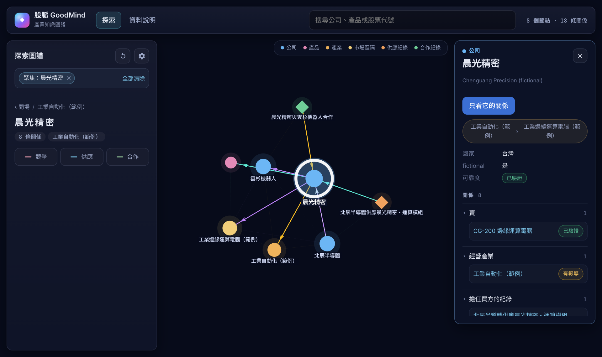
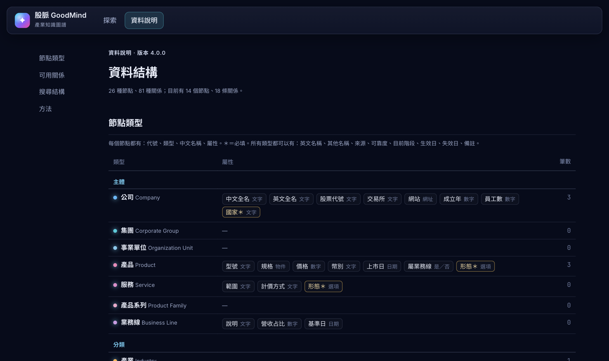
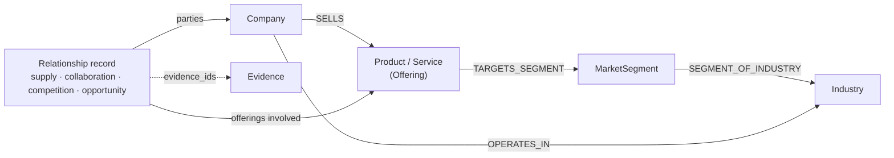
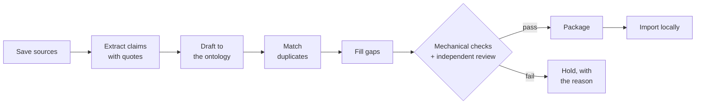
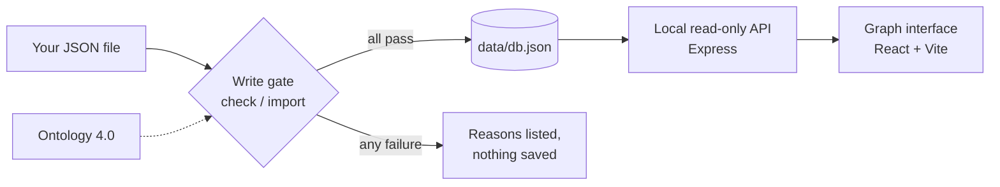

<div align="center">

# GoodMind (股脈)

**An industry knowledge graph with traceable sources**<br>
Companies, offerings, markets, and the supply, collaboration and competition links between them, organized into a graph you can query and check.

[繁體中文](README.md) ｜ **English**


[**🌐 Production site**](https://good-mind-mxn7j5.v2.appdeploy.ai/) ・ [**📖 Data guide & methodology (Chinese)**](https://good-mind-mxn7j5.v2.appdeploy.ai/#/docs) ・ [**🚀 Quick start**](#quick-start)



<sub>The local app. All companies, offerings and relations shown are fictional.</sub>

</div>

---

## Contents

- [Overview](#overview)
- [Features](#features)
- [Quick start](#quick-start)
- [Methodology](#methodology)
- [Import your own data](#import-your-own-data)
- [Clean and extract data with the skill](#clean-and-extract-data-with-the-skill)
- [Architecture](#architecture)
- [Documentation](#documentation)
- [Development](#development)
- [Notice](#notice)

## Overview

Industry research is often scattered across annual reports, announcements, news and notes. GoodMind uses an explicit ontology to turn it into nodes and relations, and records separately **who said it**, **how reliable it is** and **what stage it has reached**.

This repository provides:

| | What you get |
|---|---|
| 🧭 **Method** | The ontology, reliability labels and research pipeline |
| 💻 **Local app** | Browse and query a graph on your own computer |
| 📥 **Data import** | Load your own data from JSON that follows the spec |
| 🤖 **Data skill** | Help to clean, extract and verify data, then import it locally |
| 📚 **Spec documents** | Data format, node types, relations and rules |

> [!NOTE]
> **The repository contains no research data.** The graph starts empty; only a fictional example is included.

The interface and several data labels are in Traditional Chinese.

## Features

| Feature | Description |
|---|---|
| **Interactive graph** | 2D by default; switch to 3D under ⚙ → 圖譜顯示 |
| **Guided browsing** | Narrow down from industry to market segment to company |
| **Condition search (GQC)** | Combine conditions with all / any / not |
| **Relation lenses** | Show only competition, supply or collaboration |
| **Node details** | Attributes, relations, reliability and sources |
| **Connection paths** | Find links of up to 3 hops between two nodes |
| **Suggested links** | Inferred from shared groups and marked apart from facts |
| **Data guide page** | Look up node types, relations and method inside the app |

<details>
<summary><b>Data guide screenshot</b></summary>
<br>

</details>

## Quick start

**Requirements:** [Node.js](https://nodejs.org/) 22.12 or later, and npm.

**1. Install**

```bash
git clone https://github.com/CJsGit-tech/GoodMind-Stock.git
cd GoodMind-Stock
npm install
```

**2. Import the fictional example**

```bash
npm run import -- examples/example-ops.json
```

**3. Start**

```bash
npm run dev
```

Open **http://localhost:3100**. The API server accepts connections from your computer only.

## Methodology

Ontology **4.0** defines 26 usable node types (plus 1 abstract "offering" type) and 81 relation types: 71 can be imported, and 10 are computed or only suggested.

### Data model



| Layer | Main node types | Question answered |
|---|---|---|
| Actors and offerings | Company, Corporate Group, Organization Unit, Product, Service, Business Line | Who does business, and what do they sell? |
| Classification | Industry, Market Segment, Product Category, Technology, Application | Which market is it in, and what technology does it use? |
| Relationship records | Supply Relationship, Customer Opportunity, Collaboration, Competition Assessment | What happened between companies? |
| Sources | Evidence, Claim | Who says so? |
| Extensions | Value Chain Stage, Capability, Facility, End Market, Topic, Event, Topic Mention, ETF | Value-chain position, trends and holdings |

### Six principles

1. **Chinese first.** Names are in Traditional Chinese; English names and aliases go in attributes. Without a reliable Chinese name, keep the original; never translate one yourself.
2. **Facts need sources.** Supply, collaboration, competition and similar records must cite evidence; citing it for other facts is recommended.
3. **Reliability and stage are separate.** They are different fields.
4. **Facts, computed links and suggestions are separate.** Company-to-company links are computed from records. A shared market or technology only produces a suggestion, not a fact.
5. **One write gate.** Each batch is checked against the ontology and saved only if all of it passes.
6. **Smaller and right.** What cannot be sourced is held or left as a gap, not guessed.

### Reliability and stage

| Field | Answers | Values |
|---|---|---|
| `verification_status` | How reliable is the claim? | `verified` · `reported` · `inferred` · `suggested` · `disputed` |
| `lifecycle_status` | How far has it progressed? | `announced` · `active` · `completed` · `expired` |

> [!TIP]
> An announced MOU can be verified without implying any revenue.

### Research pipeline



### Querying

Condition search follows only **registered paths**: the same conditions on the same data give the same results. Each company appears once, with its matching paths and sources. Missing data is reported as "unknown", not treated as "no".

## Import your own data

Clear the example first:

```bash
npm run reset
```

Prepare a JSON file following the [data format and import spec](docs/DATA-SPEC.en.md), then check it and import it:

```bash
npm run check -- my-data.json
```

```bash
npm run import -- my-data.json
```

| Command | What it does |
|---|---|
| `npm run check` | Validates without saving and lists every reason for refusal |
| `npm run import` | Saves only if the whole batch passes; keeps one backup of the earlier data |
| `npm run reset` | Empties your local graph |

Your data lives in `data/db.json` on your computer and is not tracked by git. The import checks do **not** verify your sources for you.

## Clean and extract data with the skill

The repository includes the [`goodmind-data`](.claude/skills/goodmind-data/SKILL.md) skill. Open the repository in [Claude Code](https://claude.com/claude-code) and describe what you want, for example:

> Use goodmind-data to turn the `~/my-research` folder into graph data, and import what passes into my local server.

It saves sources, extracts claims with quotes, drafts to the ontology, matches duplicates, has a separate agent verify, and packages only the records that pass. **It reports to you and asks before importing.**

- Needs Python 3; reading PDFs needs `pdftotext`.
- You approve new industries and market segments first (the list is [`taxonomy.json`](.claude/skills/goodmind-data/taxonomy.json) and starts empty).

> [!IMPORTANT]
> With an AI tool, the material you give it is handled under that tool's terms. Verification can still be wrong, so review important data yourself.

## Architecture



```text
.
├── src/                   Front-end interface and graph views
├── server/                Local read-only API
├── lib/                   Ontology, write gate, query and derivation rules
├── scripts/               Check, import, reset, doc generation and tests
├── docs/                  Spec documents and screenshots
├── examples/              Fictional example data
├── data/seed.json         Empty starter graph
└── .claude/skills/        goodmind-data skill
```

## Documentation

| Document | Contents |
|---|---|
| [Data format and import spec](docs/DATA-SPEC.en.md) | File format, naming, relationship records, import checks |
| [Ontology reference](docs/ONTOLOGY.md) | All node types, attributes, relations and rules |
| [Ontology registry](lib/registry.v4.json) | Machine-readable definition |
| [Fictional example](examples/example-ops.json) | A complete file you can import |

## Development

| Command | What it does |
|---|---|
| `npm run dev` | Starts the local interface and API |
| `npm run typecheck` | TypeScript type check |
| `npm test` | Query (GQC) tests |
| `npm run build` | Type-checks and builds the front end |
| `npm run docs:ontology` | Regenerates the ontology reference from the code |

## Notice

The graph is for research only and is **not investment advice**. Check the original sources before relying on any data.
