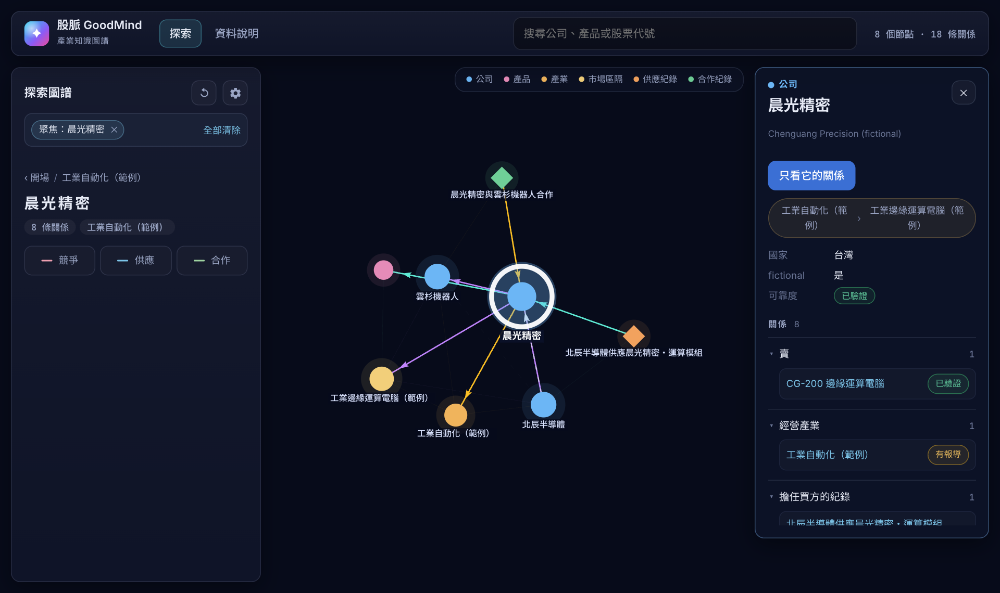
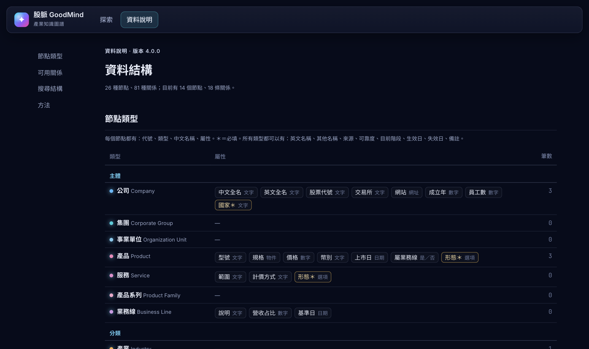
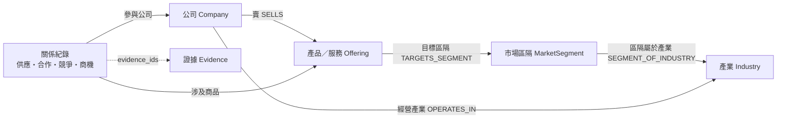
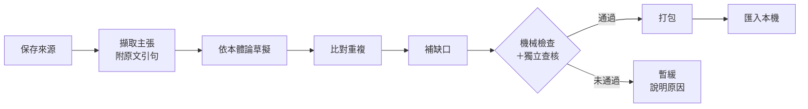
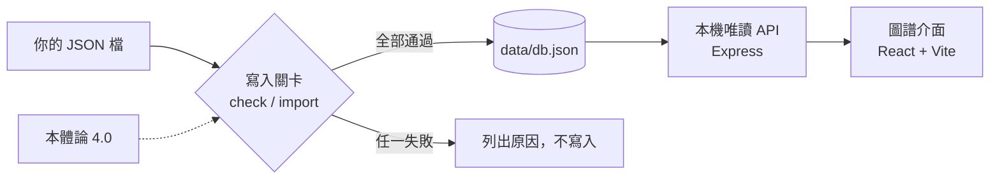

<div align="center">

# 股脈 GoodMind

**可追溯來源的產業知識圖譜**<br>
把公司、商品、市場與它們之間的供應、合作、競爭關係，整理成可查詢、可查證的圖譜。

**繁體中文** ｜ [English](README.en.md)


[**🌐 正式網站**](https://good-mind-mxn7j5.v2.appdeploy.ai/) ・ [**📖 資料說明與方法**](https://good-mind-mxn7j5.v2.appdeploy.ai/#/docs) ・ [**🚀 快速開始**](#快速開始)



<sub>本機版本畫面。圖中公司、商品與關係皆為虛構範例。</sub>

</div>

---

## 目錄

- [專案簡介](#專案簡介)
- [主要功能](#主要功能)
- [快速開始](#快速開始)
- [研究方法](#研究方法)
- [匯入自己的資料](#匯入自己的資料)
- [用 skill 清理與擷取資料](#用-skill-清理與擷取資料)
- [系統架構](#系統架構)
- [文件](#文件)
- [開發](#開發)
- [聲明](#聲明)

## 專案簡介

產業研究常散落在年報、公告、新聞與筆記裡。股脈用一套明確的本體論，把這些資訊整理成節點與關係，並分開記錄**誰說的**、**有多可靠**、**目前到哪個階段**。

這個儲存庫提供：

| | 內容 |
|---|---|
| 🧭 **研究方法** | 本體論、可靠度標記與研究流程 |
| 💻 **本機版本** | 在自己的電腦上瀏覽與查詢圖譜 |
| 📥 **資料匯入** | 以規格化的 JSON 匯入自己的資料 |
| 🤖 **資料整理 skill** | 協助清理、擷取、查核，再匯入本機 |
| 📚 **規格文件** | 資料格式、節點類型、關係與規則 |

> [!NOTE]
> **儲存庫不含研究資料。** 圖譜起始為空，只附一組虛構範例。

## 主要功能

| 功能 | 說明 |
|---|---|
| **互動圖譜** | 預設為 2D 畫面，可在 ⚙ → 圖譜顯示切換 3D |
| **引導式瀏覽** | 依產業、市場區隔一路縮小到公司 |
| **條件查詢 (GQC)** | 以「全部符合／任一符合／排除」組合條件 |
| **關係檢視** | 只看競爭、供應或合作 |
| **節點資料** | 查看屬性、關係、可靠度與來源 |
| **連結路徑** | 找出兩個節點之間 3 層以內的連結 |
| **建議關係** | 由共同分組推算，與事實分開標示 |
| **資料說明頁** | 在畫面中查閱節點類型、關係與方法 |

<details>
<summary><b>資料說明頁畫面</b></summary>
<br>

</details>

## 快速開始

**需求：** [Node.js](https://nodejs.org/) 22.12 以上版本與 npm。

**1. 安裝**

```bash
git clone https://github.com/CJsGit-tech/GoodMind-Stock.git
cd GoodMind-Stock
npm install
```

**2. 匯入虛構範例**

```bash
npm run import -- examples/example-ops.json
```

**3. 啟動**

```bash
npm run dev
```

開啟 **http://localhost:3100**。伺服器只接受本機連線的 API 請求。

## 研究方法

本體論 **4.0** 定義了 26 種可使用的節點類型（另有 1 種抽象的「商品」類型）與 81 種關係：71 種可以匯入，10 種由系統算出或僅作建議。

### 資料模型



| 層次 | 主要節點類型 | 回答的問題 |
|---|---|---|
| 主體與商品 | 公司、集團、事業單位、產品、服務、業務線 | 誰在做生意？賣什麼？ |
| 分類 | 產業、市場區隔、產品類別、技術、應用 | 屬於哪個市場？用什麼技術？ |
| 關係紀錄 | 供應紀錄、客戶商機、合作紀錄、競爭評估 | 公司之間發生了什麼？ |
| 來源 | 證據、主張 | 這件事是誰說的？ |
| 延伸 | 產業鏈階段、製程能力、工廠、終端需求、趨勢主題、事件、主題提及、ETF | 產業鏈位置、趨勢與持股 |

### 六項原則

1. **中文為主。** 名稱使用繁體中文，英文與別名放在屬性。沒有可靠的中文名稱時保留原文，不自行翻譯。
2. **事實要有來源。** 供應、合作、競爭等紀錄一定要附證據；其他事實也建議附上。
3. **可靠度與階段分開。** 兩者是不同欄位。
4. **事實、推算、建議分開。** 公司之間的關係由紀錄推算；同市場或同技術只產生建議，不當成事實。
5. **單一寫入關卡。** 每批資料依本體論檢查，全部通過才寫入。
6. **寧可少而正確。** 查不到的資料列為暫緩或缺漏，不猜測。

### 可靠度與目前階段

| 欄位 | 回答 | 可用的值 |
|---|---|---|
| `verification_status` | 這個說法有多可靠？ | `verified` 已驗證・`reported` 有報導・`inferred` 推論・`suggested` 建議・`disputed` 有爭議 |
| `lifecycle_status` | 事情進行到哪裡？ | `announced` 已公告・`active` 進行中・`completed` 已完成・`expired` 已失效 |

> [!TIP]
> 已公告的合作備忘錄可以是「已驗證」，但不代表已經產生營收。

### 研究流程



### 查詢方式

條件查詢只走**登記過的路徑**：相同的條件與資料會得到相同結果。每家公司只出現一次，並列出符合的路徑與來源；缺資料標示為「未知」，不當成「沒有」。

## 匯入自己的資料

先清空範例：

```bash
npm run reset
```

依 [資料格式與匯入規格](docs/DATA-SPEC.md) 準備 JSON 檔，先檢查，再匯入：

```bash
npm run check -- my-data.json
```

```bash
npm run import -- my-data.json
```

| 指令 | 作用 |
|---|---|
| `npm run check` | 只檢查，不寫入，並列出所有退回原因 |
| `npm run import` | 整批通過才寫入；匯入前的資料保留一份備份 |
| `npm run reset` | 清空本機圖譜 |

你的資料存在本機的 `data/db.json`，不會被 git 追蹤。匯入檢查**不會**替你查證來源內容。

## 用 skill 清理與擷取資料

儲存庫附有 [`goodmind-data`](.claude/skills/goodmind-data/SKILL.md) skill。在 [Claude Code](https://claude.com/claude-code) 中開啟本儲存庫並描述需求，例如：

> 用 goodmind-data 把 `~/my-research` 資料夾整理成圖譜資料，通過檢查後匯入我的本機。

它的流程是保存來源、擷取附引句的主張、依本體論草擬、比對重複、交給獨立代理查核，最後只打包通過的紀錄。**匯入前會先向你報告並徵求同意。**

- 需要 Python 3；讀取 PDF 需要 `pdftotext`。
- 新的產業與市場區隔要先經你核准（清單在 [`taxonomy.json`](.claude/skills/goodmind-data/taxonomy.json)，起始為空）。

> [!IMPORTANT]
> 使用 AI 工具時，你提供的資料會依該工具的條款處理。查核結果仍可能出錯，重要資料請自行覆核。

## 系統架構



```text
.
├── src/                   前端介面與圖譜
├── server/                本機唯讀 API
├── lib/                   本體論、寫入關卡、查詢與推算規則
├── scripts/               檢查、匯入、清空、產生文件與測試
├── docs/                  規格文件與畫面
├── examples/              虛構範例資料
├── data/seed.json         空白起始圖譜
└── .claude/skills/        goodmind-data skill
```

## 文件

| 文件 | 內容 |
|---|---|
| [資料格式與匯入規格](docs/DATA-SPEC.md) | 檔案格式、命名、關係紀錄、匯入檢查 |
| [本體論參考](docs/ONTOLOGY.md) | 所有節點類型、屬性、關係與規則 |
| [本體論定義檔](lib/registry.v4.json) | 機器可讀的定義 |
| [虛構範例](examples/example-ops.json) | 可直接匯入的完整範例 |

## 開發

| 指令 | 作用 |
|---|---|
| `npm run dev` | 啟動本機介面與 API |
| `npm run typecheck` | TypeScript 型別檢查 |
| `npm test` | 查詢 (GQC) 測試 |
| `npm run build` | 型別檢查並建置前端 |
| `npm run docs:ontology` | 由程式重新產生本體論參考 |

## 聲明

圖譜僅供研究參考，**不是投資建議**。使用任何資料前請查核原始來源。
